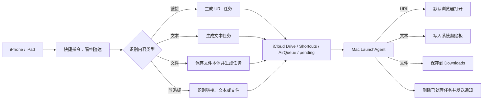
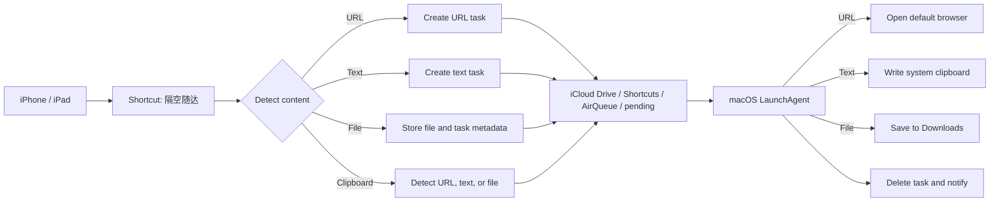

# AirQueue（隔空随达）

## 把 iPhone 上的内容，安静地送到 Mac

AirQueue 是一个基于 **iCloud Drive + Apple 快捷指令 + macOS 后台服务** 的跨设备内容投递工具。

当 AirDrop 不方便、Mac 暂时不在线，或者你不想在手机和电脑之间反复切换时，只需在 iPhone 或 iPad 上分享一次内容。AirQueue 会把任务放入 iCloud 队列，Mac 登录后自动接收并处理：

- 链接自动用默认浏览器打开
- 文本自动写入 Mac 剪贴板
- 文件自动保存到 `~/Downloads`
- 剪贴板中的链接、文本和文件也可以直接投递

它不需要自建服务器、不需要公网 IP，也不需要额外账号；iCloud Drive 就是可靠的跨设备中转站。

> [!IMPORTANT]
> **使用 AirQueue 前，必须先在 iPhone 或 iPad 上安装快捷指令「隔空随达」。**
>
> [点击安装「隔空随达」快捷指令](https://www.icloud.com/shortcuts/5a2680bdad354c33b1e304db89f9b9a8)

## :bulb: 使用场景：先发现，随后达

手机或 iPad 上发现了好的文章、链接、文字或文件，但 Mac 不在身边？不用等回到电脑旁，也不用把内容发到微信、QQ 或其他社交工具里。点一下「隔空随达」，内容就会进入你自己的 iCloud 队列，等你回到 Mac、登录系统后自动处理。

> **手机 / iPad 上发现好东西，Mac 不在身边？先发走，随后在 Mac 上看到——就隔空随达。**

这是一种更专注、更可控的跨设备工作方式：

- :sparkles: 不打断当前浏览，不需要立即打开 Mac
- :lock: 不经过微信等社交工具，不依赖聊天窗口或第三方机器人
- :cloud: 使用自己的 iCloud Drive 作为中转，传输内容和队列由自己掌握
- :computer: 回到 Mac 后自动打开链接、保存文件或准备好剪贴板文本

## :sparkles: 核心特色

### :cloud: 异步送达，不依赖 Mac 实时在线

AirQueue 采用文件队列而不是实时连接。手机端先将任务写入 iCloud Drive，Mac 端在登录后自动扫描并处理，因此不要求两台设备同时在线，也不受 AirDrop 距离和发现状态影响。

### :iphone: 一个快捷指令覆盖多种内容

快捷指令「隔空随达」作为分享表单扩展运行，可接收 URL、文本、文件等常见内容；同时支持读取当前剪贴板，将剪贴板内容投递到 Mac。

### :mag: 自动识别内容类型

它会根据输入内容自动选择处理路径：

- URL：生成链接任务，Mac 端打开默认浏览器
- 普通文本：生成文本任务，Mac 端写入剪贴板
- 文件：先传输文件本体，再生成文件任务描述，Mac 端保存到 Downloads
- 剪贴板：区分剪贴板链接、文本和文件，沿用对应处理逻辑

### :computer: Mac 端零操作

安装脚本会注册 LaunchAgent。服务在用户登录时启动，并由 iCloud 队列目录变化触发处理；任务成功后自动删除队列文件，并通过系统通知反馈结果。

### :clipboard: 与剪贴板工作流自然衔接

文本任务写入系统剪贴板后，可直接在 Mac 上按 `⌘V` 使用；如果同时运行剪贴板历史工具，例如 OwlLinkerHS，剪贴板变化也可以被其监听并记录。

### :shield: 有日志、有重试、有失败保护

Mac 服务具备以下基础可靠性措施：

- iCloud 文件同步完成后再读取
- JSON 解析失败时尝试抢救任务类型和正文
- 处理失败自动重试，连续失败后记录并通知
- 运行日志与错误日志可独立查看
- 文本只有在 `pbcopy` 成功后才从队列中删除

## :arrows_counterclockwise: 工作流程



## :link: 快捷指令

直接使用 Apple iCloud 分享链接安装：

**[获取「隔空随达」快捷指令](https://www.icloud.com/shortcuts/5a2680bdad354c33b1e304db89f9b9a8)**

快捷指令信息：

| 项目 | 内容 |
|---|---|
| 名称 | 隔空随达 |
| 类型 | 分享表单扩展（Action Extension） |
| 支持输入 | URL、文本、文件、剪贴板内容 |
| 队列目录 | `Shortcuts/AirQueue/pending/` |
| 时间戳格式 | `yyyyMMddHHmmss` |
| 任务文件 | `task_时间戳` |
| 文件任务 | 原文件 + JSON 任务描述 |

快捷指令会先获取当前日期并生成秒级时间戳，再根据内容类型构造任务。完成后会显示通知，提示任务已送达指定 Mac。

## :rocket: 快速开始

### 1. 安装快捷指令

在 iPhone 或 iPad 上打开上面的 iCloud 链接，点击「获取快捷指令」或「添加快捷指令」。首次使用时，建议先运行一次，使 iCloud Drive 自动创建队列目录。

### 2. 确认 iCloud Drive

发送端和接收端需要使用同一个 Apple 账户，并确保两台设备都开启了 iCloud Drive 与快捷指令同步。

### 3. 获取 Mac 端程序

```bash
git clone https://github.com/OwlLinker/AirQueue.git
cd AirQueue
bash install_airqueue.sh
```

安装脚本会：

1. 检查 Python 3 和 iCloud 队列目录
2. 创建后台服务所需目录
3. 注册 `com.user.airqueue` LaunchAgent
4. 配置队列目录变化触发机制
5. 写入 AirQueue 管理命令

脚本可能会引导你为运行安装脚本的终端和后台 Python 开启「完全磁盘访问」权限。这是 macOS 对 iCloud 文件目录和后台进程的系统保护要求。

## :mailbox: 使用方式

### 从分享菜单发送

在 iPhone 或 iPad 上：

1. 在 Safari、文件、照片或其他 App 中选择内容
2. 点击「分享」
3. 选择「隔空随达」
4. 选择链接、文字或文件类型（如快捷指令提示选择）
5. 等待 AirQueue 完成通知

### 直接发送当前剪贴板

直接运行「隔空随达」快捷指令即可读取当前剪贴板：

- 剪贴板是链接：Mac 自动打开链接
- 剪贴板是文本：Mac 自动写入剪贴板
- 剪贴板是文件：Mac 自动保存文件
- 剪贴板为空：快捷指令提示「剪贴板是空的」

## :computer: Mac 端处理结果

| 输入类型 | Mac 端行为 |
|---|---|
| 分享链接 | 使用默认浏览器打开 |
| 分享文本 | 写入系统剪贴板，可直接 `⌘V` 粘贴 |
| 分享文件 | 保存到 `~/Downloads` 并打开文件夹 |
| 剪贴板链接 | 使用默认浏览器打开 |
| 剪贴板文本 | 写入系统剪贴板 |
| 剪贴板文件 | 保存到 `~/Downloads` |

## :page_facing_up: 任务格式

AirQueue 使用简单、可诊断的 JSON 任务描述。以下为逻辑格式示例：

### 链接任务

```json
{
  "type": "url",
  "content": "https://example.com",
  "from": "iPhone",
  "time": "20260826123456"
}
```

### 文本任务

```json
{
  "type": "text",
  "content": "要发送到 Mac 的文字",
  "from": "iPhone",
  "time": "20260826123456"
}
```

### 文件任务

```json
{
  "type": "file",
  "filename": "example.pdf",
  "from": "iPhone",
  "time": "20260826123456"
}
```

文件任务由两部分组成：队列目录中的文件本体，以及描述文件名和任务类型的 JSON 文件。

## :gear: 常用管理命令

安装脚本完成后，重新打开终端或执行 `source ~/.zshrc`，即可使用：

```bash
airqueue_status      # 查看服务状态
airqueue_start       # 启动服务
airqueue_stop        # 停止服务
airqueue_log         # 查看运行日志
airqueue_errors      # 查看错误日志
airqueue_uninstall   # 卸载服务，保留 iCloud 队列目录
```

默认日志文件：

```text
~/.airqueue.log
```

## :mag: 故障排查

### Mac 没有收到任务

1. 确认 Mac 已登录与 iPhone 相同的 Apple 账户
2. 确认 iCloud Drive 和快捷指令同步已开启
3. 确认快捷指令确实显示发送成功通知
4. 执行 `airqueue_status` 查看服务是否已注册
5. 执行 `airqueue_log` 查看最近一次处理记录
6. 确认队列目录位于 `Shortcuts/AirQueue/pending/`

### 文本没有出现在剪贴板历史中

AirQueue 会先使用 macOS 的 `pbcopy` 写入系统剪贴板，再由剪贴板历史工具监听系统剪贴板变化。请确认：

- AirQueue 日志中出现 `Copied text to clipboard`
- 剪贴板历史工具正在运行
- 剪贴板历史工具的监听模块已初始化

### 文件处理失败

检查 Python 后台进程的「完全磁盘访问」权限，并确认 iCloud 文件已经完成同步。AirQueue 会在同步超时或处理失败时保留任务并重试。

## :warning: 注意事项

- AirQueue 依赖 iCloud Drive 的最终一致性，任务送达可能需要几秒钟。
- Mac 端服务需要在用户登录后运行；关机或未登录期间的任务会留在 iCloud 队列中，之后继续处理。
- 任务文件使用秒级时间戳命名；不建议在同一秒内连续发送大量同类型任务。
- 文件内容会经过 Apple iCloud Drive 传输；它不会经过微信等社交工具，但仍请确认内容符合你的隐私和合规要求。
- 分享快捷指令前，请检查其中是否包含个人信息、固定路径或不应公开的配置。

## :file_folder: 项目结构

```text
AirQueue/
├── .gitignore
├── install_airqueue.sh
├── AirQueue_快捷指令设置指南.md
└── README.md
```

## :scroll: 许可证

当前仓库尚未声明开源许可证。除非另有明确授权，请不要默认将代码用于再发布或商业分发。

---

# AirQueue (隔空随达) — English

## :sparkles: Send content from iPhone to Mac

AirQueue is a cross-device delivery tool built on **iCloud Drive, Apple Shortcuts, and a macOS background service**.

When AirDrop is inconvenient, your Mac is temporarily offline, or you simply want to avoid switching between devices, share the content once from your iPhone or iPad. AirQueue places the task in an iCloud queue and processes it automatically when the Mac is available:

- :link: URLs open in the default browser
- :clipboard: Text is written to the macOS clipboard
- :file_folder: Files are saved to `~/Downloads`
- :package: Clipboard URLs, text, and files can also be delivered directly

AirQueue requires no custom server, public IP address, or additional account. iCloud Drive acts as the cross-device transport layer.

> [!IMPORTANT]
> **Install the “隔空随达” Shortcut on your iPhone or iPad before installing AirQueue on your Mac.**
>
> :arrow_down: [Install the “隔空随达” Shortcut](https://www.icloud.com/shortcuts/5a2680bdad354c33b1e304db89f9b9a8)

## :bulb: Use case: discover now, reach your Mac later

You find a great article, link, piece of text, or file on your phone or iPad, but your Mac is not nearby. You do not need to wait, return to the computer, or send the content through WeChat, QQ, or another social app. Tap **隔空随达** once: the content enters your own iCloud queue and is processed automatically when you return to your Mac and log in.

> **Found something useful on your phone or iPad while your Mac is away? Send it now, see it later on your Mac — 隔空随达.**

This gives you a focused and more controllable cross-device workflow:

- :sparkles: Keep browsing without interrupting your current task
- :lock: Avoid social apps, chat windows, and third-party bots
- :cloud: Use your own iCloud Drive as the transport layer
- :computer: Let the Mac open the link, save the file, or prepare the text in your clipboard later

## :star2: Highlights

### :cloud: Asynchronous delivery

AirQueue uses a file queue instead of a live connection. The phone writes a task to iCloud Drive first, and the Mac processes it after login. The devices do not need to be online at the same time.

### :iphone: One Shortcut, multiple content types

The “隔空随达” Shortcut runs as a Share Sheet action extension. It accepts URLs, text, and files, and can also read the current clipboard when run directly.

### :mag: Automatic content routing

AirQueue identifies the content and selects the matching workflow:

- :link: URL → create a URL task → open it on the Mac
- :memo: Text → create a text task → write it to the Mac clipboard
- :page_facing_up: File → upload the file and task metadata → save it to Downloads
- :clipboard: Clipboard → detect URL, text, or file → use the matching workflow

### :computer: Zero-touch Mac processing

The installer registers a LaunchAgent. The service starts at user login, watches the iCloud queue directory, processes tasks, removes successfully handled files, and sends a macOS notification.

### :shield: Built-in resilience

- Waits for iCloud synchronization before reading a task
- Attempts to recover the type and content from malformed JSON
- Retries failed tasks and records repeated failures
- Keeps a runtime log and an error log
- Removes text tasks only after `pbcopy` succeeds

## :arrows_counterclockwise: Architecture



## :link: Shortcut

**[Get the “隔空随达” Shortcut](https://www.icloud.com/shortcuts/5a2680bdad354c33b1e304db89f9b9a8)**

| Property | Value |
|---|---|
| Name | 隔空随达 |
| Type | Share Sheet action extension |
| Inputs | URL, text, file, and clipboard content |
| Queue directory | `Shortcuts/AirQueue/pending/` |
| Timestamp format | `yyyyMMddHHmmss` |
| Task file | `task_<timestamp>` |
| File transfer | File payload plus JSON task metadata |

The Shortcut creates a timestamp, classifies the input, writes a JSON task to the queue, and displays a completion notification.

## :rocket: Quick start

### 1. Install the Shortcut

Open the iCloud link on an iPhone or iPad and tap **Get Shortcut** or **Add Shortcut**. Run it once so iCloud Drive creates the queue directory.

### 2. Prepare iCloud Drive

Use the same Apple Account on the sending device and the Mac. Make sure iCloud Drive and Shortcuts sync are enabled on both devices.

### 3. Install the Mac service

```bash
git clone https://github.com/OwlLinker/AirQueue.git
cd AirQueue
bash install_airqueue.sh
```

The installer checks Python 3 and the iCloud queue directory, creates the required directories, registers `com.user.airqueue`, configures queue monitoring, and adds management commands to your shell.

macOS may ask you to grant **Full Disk Access** to the terminal running the installer and to the Python executable used by the background service.

## :mailbox: Usage

### From the Share Sheet

1. Select content in Safari, Files, Photos, or another app.
2. Tap **Share**.
3. Choose **隔空随达**.
4. Select the appropriate type if prompted.
5. Wait for the AirQueue completion notification.

### From the current clipboard

Run **隔空随达** directly:

- :link: Clipboard URL → open on the Mac
- :clipboard: Clipboard text → write to the Mac clipboard
- :page_facing_up: Clipboard file → save to Downloads
- :warning: Empty clipboard → show “剪贴板是空的”

## :computer: Mac-side results

| Input | Mac-side result |
|---|---|
| Shared URL | Open in the default browser |
| Shared text | Write to the system clipboard; paste with `⌘V` |
| Shared file | Save to `~/Downloads` and open the folder |
| Clipboard URL | Open in the default browser |
| Clipboard text | Write to the system clipboard |
| Clipboard file | Save to `~/Downloads` |

## :page_facing_up: Task format

AirQueue uses small, inspectable JSON task descriptions.

```json
{
  "type": "url",
  "content": "https://example.com",
  "from": "iPhone",
  "time": "20260826123456"
}
```

Supported task types are `url`, `text`, and `file`. File tasks include a `filename` field and are accompanied by the file payload in the queue directory.

## :gear: Management commands

After installation, reopen the terminal or run `source ~/.zshrc`:

```bash
airqueue_status      # Check service status
airqueue_start       # Start the service
airqueue_stop        # Stop the service
airqueue_log         # View the runtime log
airqueue_errors       # View the error log
airqueue_uninstall   # Uninstall the service; keep the iCloud queue
```

Default log file: `~/.airqueue.log`.

## :mag: Troubleshooting

### The Mac does not receive a task

1. Confirm both devices use the same Apple Account.
2. Confirm iCloud Drive and Shortcuts sync are enabled.
3. Confirm the Shortcut displayed its completion notification.
4. Run `airqueue_status`.
5. Run `airqueue_log` and inspect the latest entry.
6. Confirm the queue is `Shortcuts/AirQueue/pending/`.

### Text is missing from clipboard history

AirQueue writes text through macOS `pbcopy`. A clipboard history tool then needs to observe the system clipboard change. Confirm the AirQueue log contains `Copied text to clipboard`, and that the clipboard history watcher is running.

### File processing fails

Check Full Disk Access for the Python background process and wait for iCloud synchronization to finish. Failed tasks remain in the queue for retry.

## :warning: Notes and limitations

- iCloud Drive is eventually consistent; delivery may take a few seconds.
- The Mac service runs after user login. Tasks remain in iCloud while the Mac is shut down or logged out.
- Task names use second-level timestamps; avoid sending many same-type tasks within the same second.
- File content is transferred through Apple iCloud Drive rather than social apps; review your privacy and compliance requirements.
- Review the Shortcut before sharing it and remove personal information, fixed paths, or private configuration.

## :file_folder: Project layout

```text
AirQueue/
├── .gitignore
├── install_airqueue.sh
├── AirQueue_快捷指令设置指南.md
└── README.md
```

## :scroll: License

This repository does not currently declare an open-source license. Unless explicit permission is provided, do not assume the code may be redistributed or used commercially.
